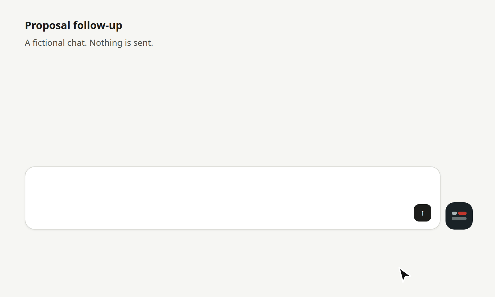

# datafog browser extension

**Catch personal details before they reach an AI chat.**

datafog checks what you type into ChatGPT, Claude, Gemini, Grok, and DeepSeek for things like email addresses, card numbers, API keys, names, and mailing addresses. When it finds one, you can mask it before you send. Everything runs on your device, so your drafts never leave your browser.

<p align="center">
  
</p>

## Features

- **Checks as you type.** A small circle beside the chat box shows what it found. Pasting is checked immediately.
- **Mask what matters.** Pick **Mask** or **Reversible mask** for each finding, or leave it as typed, then apply. Put it all back with Undo if needed.
- **Read answers with your original values.** Turn on **Show originals** in an answer to see the details you masked. The chat site only ever sees placeholders.
- **Check PDFs too.** Drop a PDF into the **Files** tab, review what it found, and insert the masked text into your draft. Scanned pages work offline.
- **Your rules.** Always allow a value you don't care about, always flag one you do, and choose which kinds of details and which sites to check.

## Mask or reversible mask?

- **Mask** swaps a detail for a label such as `[EMAIL]`. The original isn't saved, so the only way to bring it back is with Undo.
- **Reversible mask** swaps a detail for a placeholder such as `[[EMAIL_7KQ4ZM]]` and keeps the original in your vault, so you can see it in answers or copy it back later.
- **Vault** is where datafog keeps originals, rules, and settings, encrypted on your device.

⚠️ datafog finds sensitive details automatically, so it can miss some or flag things that aren't sensitive. Treat it not as a guarantee, but as a security layer for personal details.

## Install

### Chrome Web Store

Coming soon.

### From a release

1. Download `datafog-<version>.zip` from the [latest release](https://github.com/DataFog/datafog-browser-extension/releases/latest) and unzip it into a folder.
2. Open `chrome://extensions` and turn on **Developer mode**.
3. Choose **Load unpacked** and select the unzipped folder.

This copy doesn't update itself. To update, replace the folder's contents with a newer release, then choose **Reload** on datafog in `chrome://extensions`.

### From source

Requirements: Node.js 24 and Google Chrome.

```bash
git clone https://github.com/DataFog/datafog-browser-extension.git
cd datafog-browser-extension
npm ci
npm run build
```

Then load the `dist/` folder with **Load unpacked**, as in steps 2 and 3 above.

Once it's installed, open a supported chat site and try typing `my email is jane@example.com`.

Click the datafog icon in the toolbar to see saved originals and rules. The gear in that panel opens settings.

To uninstall, choose **Remove** on datafog in `chrome://extensions`. This also deletes the vault.

## Privacy

datafog checks text on your device and sends nothing anywhere. Detection is powered by [DataFog Core](https://github.com/DataFog/datafog-core). See the [privacy policy](https://datafog.ai/privacy-policy).

## Contributing and security

Contributions are welcome. See [CONTRIBUTING.md](CONTRIBUTING.md) to get started. To report a vulnerability, email help@datafog.ai or see [SECURITY.md](SECURITY.md).

## License

[MIT](LICENSE). Built by [datafog](https://datafog.ai).
